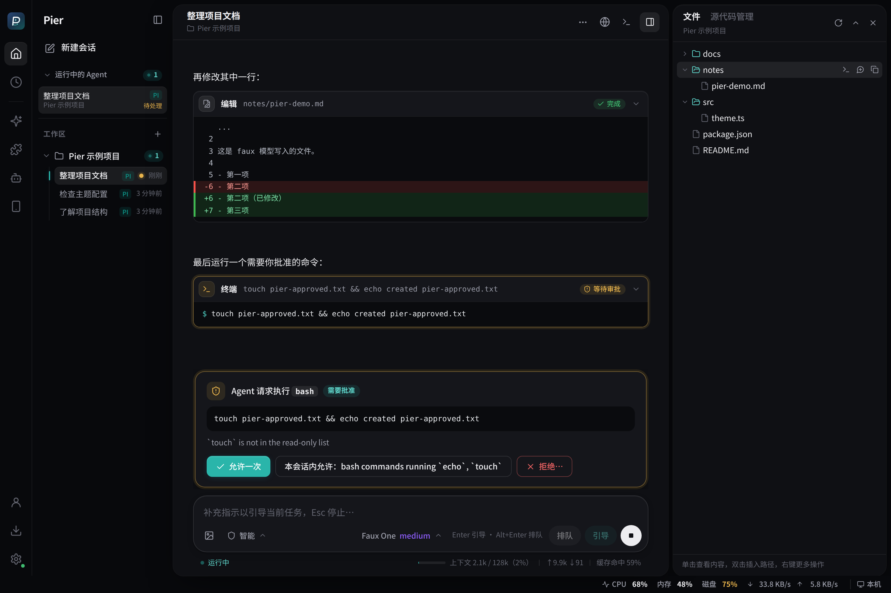
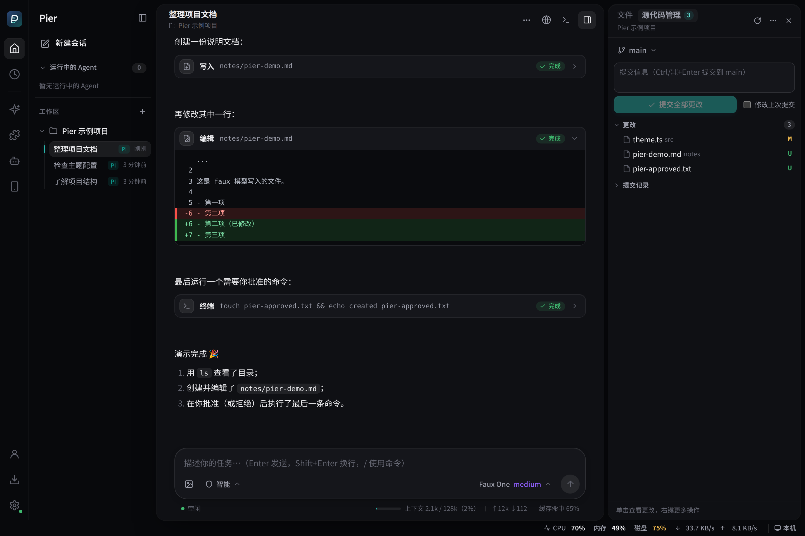
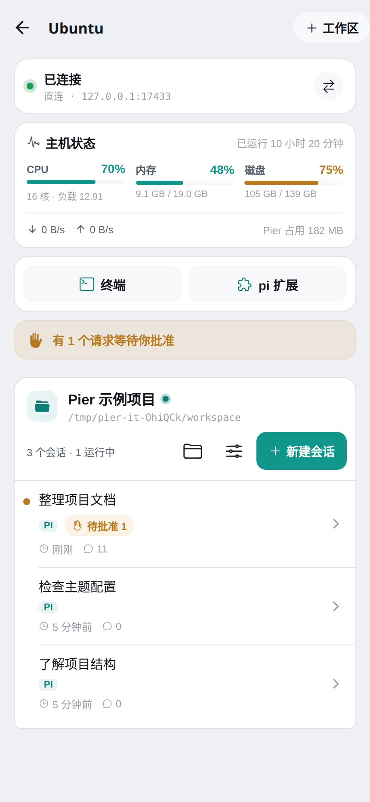
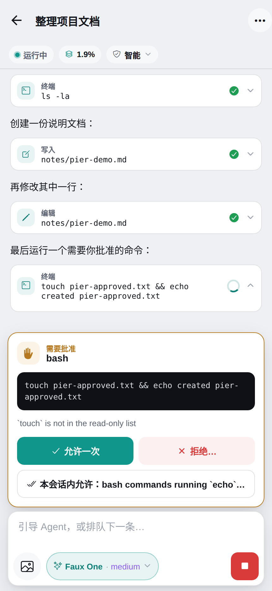

# Pier

A cross-device workbench for coding agents.

<p align="center">
  
</p>

<p align="center">
  <a href="https://github.com/yiranxiaohui/Pier/releases/latest"></a>
  <a href="https://github.com/yiranxiaohui/Pier/actions/workflows/ci.yml"></a>
</p>

Pier 是编码 Agent 的跨设备工作台：在同一个界面中使用内置的 [pi](https://github.com/earendil-works/pi) 和电脑上安装的 [Claude Code](https://code.claude.com)、[Codex](https://github.com/openai/codex)，统一管理多台电脑上的工作区与会话，并提供文件、Git 和终端操作。Agent 常驻在各自的电脑上运行，你可以从桌面端或手机端查看进度、发送指令和审批操作。

## 特性

- **一个界面，三种 Agent**：内置 pi，并驱动电脑上安装的 Claude Code 与 Codex；它们的会话与终端中的 CLI 共用，随时可以用 `claude --resume` / `codex resume` 在终端继续。
- **多台电脑统一管理**：每台电脑都是一个节点。粘贴配对链接，或通过 SSH 登录 Linux 电脑自动安装 Pier 并配对，那台电脑的工作区和会话与本机的一起列在侧边栏中。
- **手机随时跟进**：原生 App（Expo / React Native）扫码配对后查看进度、发送指令、审批操作，断线自动重连补发。
- **完整的工作台**：文件浏览、预览与编辑，Git（含工作树）、内置终端、远程浏览器、端口映射、进程管理、定时任务、Skills 与 MCP 管理、语音输入。
- **端到端加密的远程访问**：配对后的连接全程加密；不在同一网络时经自建的 [Pier Relay](apps/relay/README.md) 连接，优先打洞 P2P 直连，中继只看得到密文。
- **安装与更新省心**：Windows、macOS、Linux 都有安装包和命令行安装入口；桌面端与 Android 支持应用内更新（签名校验，可选国内加速线路），Linux 服务器可安装为后台服务。

## 安装

按你使用的设备选择，**不需要先安装 Node.js、Bun 或开发工具**。电脑端负责运行 Agent，手机端连接电脑使用；手机本身不运行 Agent。

| 平台 | 推荐安装方式 | 支持范围 |
|---|---|---|
| **Windows** | [安装程序 / PowerShell 一键安装](#windows) | Windows 10 / 11 x64；无需 WSL |
| **macOS** | [DMG / 终端一键安装](#macos) | Apple Silicon（M 系列）和 Intel；脚本需 macOS 12+ |
| **Linux 桌面** | [deb / AppImage](#linux-桌面) | x86_64 / ARM64，建议 Ubuntu 22.04+ 或兼容发行版 |
| **Linux 服务器** | [一键安装后台服务](#linux-一键安装) | x86_64 / ARM64，无需图形桌面 |
| **Android** | [APK 安装](#android) | ARM64 / ARMv7 手机、x86_64 模拟器 |
| **iOS / iPadOS** | [自行签名构建](#ios--ipados) | 暂无 App Store / TestFlight / 可直接安装的 IPA |

所有已发布安装包都在 **[GitHub Releases 最新版](https://github.com/yiranxiaohui/Pier/releases/latest)**，文件列表见[安装包](#安装包)。目前没有 Windows ARM64 / 32 位原生发行包，不要把 Linux / macOS 的 ARM64 文件用于 Windows。

### Windows

**推荐**：下载 `pier-v<版本>-windows-x64.setup.exe`，双击完成安装，再从开始菜单打开 **Pier**。安装器会按需准备 WebView2 运行时。无需在管理员终端运行，也无需安装 WSL。安装器暂未做 Windows 代码签名；若 SmartScreen 提示，请先确认来自本项目 Release，再按系统提示选择「更多信息 → 仍要运行」，不要关闭系统安全防护。

也可打开 **Windows PowerShell 5.1 或 PowerShell 7** 执行（不是 CMD / Git Bash）：

```powershell
& ([scriptblock]::Create((Invoke-RestMethod 'https://raw.githubusercontent.com/yiranxiaohui/Pier/main/scripts/install.ps1')))
```

国内网络可用镜像获取脚本，并指定安装包下载线路：

```powershell
& ([scriptblock]::Create((Invoke-RestMethod 'https://ghfast.top/https://raw.githubusercontent.com/yiranxiaohui/Pier/main/scripts/install.ps1'))) -Mirror ghfast
```

脚本从 Release 获取 x64 安装程序，**先校验 SHA-256，再打开安装向导**。支持 `-Version v0.2.60`、`-Mirror auto|github|ghfast|gh-proxy|ghproxy`（或自定义 HTTPS 前缀）、`-Silent`（静默安装）、`-Help`；也支持 `PIER_VERSION` / `PIER_MIRROR` 环境变量。默认依次尝试 GitHub 与镜像，下载失败或持续过慢时自动换线并续传；指定线路时不换线。需要系统的 `curl.exe`（新版 Windows 10 / 11 自带），没有时请使用安装包。

更新前请从托盘**完整退出 Pier**；可在应用内更新，或再次运行脚本。脚本不强制结束 Agent 会话，不安装 Windows 服务，不修改 PowerShell 执行策略。卸载用「设置 → 应用 → 已安装的应用 → Pier」，保留用户数据时不要选择删除应用数据。

### macOS

**推荐**：Apple Silicon 下载 `pier-v<版本>-darwin-arm64.dmg`，Intel 下载 `pier-v<版本>-darwin-x64.dmg`，打开后将 **Pier.app** 拖入「应用程序」，再从 Finder 打开。

也可在「终端」执行（macOS 12+，**不要加 sudo**）：

```bash
curl -fsSL https://raw.githubusercontent.com/yiranxiaohui/Pier/main/scripts/install.sh | bash
```

脚本自动识别 Intel / Apple Silicon（包括 Rosetta 下的终端），下载并校验对应 DMG 的 SHA-256、应用标识、版本和本机签名。默认安装到 `~/Applications/Pier.app`；已有 `/Applications/Pier.app` 时沿用该位置。不会安装 systemd / launchd 服务，也不会修改 Gatekeeper 或自动清除隔离标记。目标目录不可写时会提示，不会自动提权。

可指定位置、版本和镜像，例如：

```bash
curl -fsSL https://ghfast.top/https://raw.githubusercontent.com/yiranxiaohui/Pier/main/scripts/install.sh | bash -s -- --mirror ghfast --app-dir "$HOME/Applications"
```

支持 `--version`、`--mirror`、`--force`、`--app-dir`（或 `PIER_APP_DIR`），下载线路与下面的 Linux 脚本相同；Linux 的 `--service` / `--portable` / `--user` / `--system` / `--no-start` 参数不适用于 macOS。更新前从托盘完整退出 Pier；更新失败保留旧应用，不删除 `~/.pier` 或 Agent 数据。

**首次打开**：目前为 ad-hoc 签名，未经 Apple 公证。若 macOS 阻止启动，请先尝试打开一次，再到「系统设置 → 隐私与安全性」选择「仍要打开」，详见[平台说明](docs/guide.md#平台说明)。后续可在应用内更新，卸载时退出 Pier 并将 `Pier.app` 移到废纸篓即可。

### Linux 桌面

Debian / Ubuntu 推荐下载对应架构的 `.deb`，在下载目录安装（示例版本请替换为实际版本）：

```bash
sudo apt install ./pier-v0.2.60-linux-x64.deb
pier
```

其他发行版可使用 `.AppImage`：

```bash
chmod +x ./pier-v0.2.60-linux-x64.AppImage
./pier-v0.2.60-linux-x64.AppImage
```

ARM64 将文件名中的 `linux-x64` 换成 `linux-arm64`。AppImage 需要 FUSE；缺少 FUSE 时可用 `./pier-v0.2.60-linux-x64.AppImage --appimage-extract-and-run`。仍需系统图形会话和 GTK / WebKit 等运行库，不支持直接在 Alpine / musl 环境运行。桌面端不要用 root 启动。也可以使用下面的一键脚本，检测到图形会话时默认只安装 `pier` 命令。

### Linux 一键安装

适用于 Linux 服务器和无图形界面的电脑（x86_64 / arm64）。用之后要运行 Agent 的账号执行：

```bash
curl -fsSL https://raw.githubusercontent.com/yiranxiaohui/Pier/main/scripts/install.sh | bash
```

国内网络连不上 `raw.githubusercontent.com` 时，改用镜像获取脚本（任选一条；脚本内容与上面完全相同，安装文件仍可按[下载线路](#下载线路)选择线路并校验）：

```bash
# GHFast
curl -fsSL https://ghfast.top/https://raw.githubusercontent.com/yiranxiaohui/Pier/main/scripts/install.sh | bash
# GH-Proxy
curl -fsSL https://gh-proxy.com/https://raw.githubusercontent.com/yiranxiaohui/Pier/main/scripts/install.sh | bash
# GHProxy
curl -fsSL https://ghproxy.net/https://raw.githubusercontent.com/yiranxiaohui/Pier/main/scripts/install.sh | bash
```

脚本从 GitHub Release 下载最新的 `pier` 单文件，按 Release 的 `SHA256SUMS.txt` 校验并核对版本，再用 `pier install` 安装为后台服务和 `pier` 命令：

- 普通账号安装为 systemd 用户服务（程序在 `~/.local/share/pier`，命令为 `~/.local/bin/pier`），并在无需密码时开启 linger，让服务在退出 SSH 后继续运行、开机自动启动；用 `curl … | sudo bash` 以 root 执行则安装为系统服务（`/opt/pier`、`/usr/local/bin/pier`）。
- 有图形桌面时默认只安装 `pier` 命令（运行 `pier` 打开桌面界面），不安装后台服务，因为桌面窗口和后台服务不能同时使用同一个状态目录；需要服务时加 `--service`。已经安装过的电脑沿用原来的方式。
- 没有 systemd 管理器（例如容器中）时只安装、不启动，之后用 `pier run` 运行。
- 再次执行即更新到最新版，已是最新版时直接退出；安装为服务后也可以用 `pier update` 更新，它同样在终端中让你选择下载线路、下载中按 `s` 重新选择，也支持 `--mirror` 指定线路。Pier 状态（`~/.pier`）、配对和 Agent 数据保持不变。

#### 下载线路

Linux / macOS 脚本的安装文件可以经 GitHub 直连或 GHFast（`ghfast.top`）、GH-Proxy（`gh-proxy.com`）、GHProxy（`ghproxy.net`）加速线路下载：

- **手动选线（终端中默认）**：在终端中运行且没有指定 `--mirror` 时，脚本不再测速，而是列出 GitHub、GHFast、GH-Proxy、GHProxy 让你输入编号选择（直接回车用默认项：GitHub 能连通时为 GitHub，否则为 GHFast），也可以粘贴自定义的 `https://` 加速前缀，或输入 `a` 改用自动选线。选好的线路固定使用，失败时在这条线路上重试。
- **下载中换线**：在终端中下载时按 `s`，重新列出线路供选择（回车为下一条），并从已下载的位置接着下载。
- **自动选线**：`--mirror auto`，或没有终端（例如 CI、`ssh host 'curl … | bash'`）时使用。GitHub 直连足够快（2 MB/s 以上）时直接使用；否则同时测速各条加速线路，从最快的开始下载。某条线路断开或连续 20 秒低于 100 KB/s 时，自动换到下一条线路，并且从已下载的位置接着下载。只有 wget 时不测速，依次尝试 GitHub 与各条加速线路。
- **指定线路**：`--mirror ghfast`（或 `github`、`gh-proxy`、`ghproxy`、自定义的 `https://` 加速前缀）跳过选择菜单，固定从这条线路下载，失败时在这条线路上重试，不会自动换线；按 `s` 仍可手动换线。

无论走哪条线路，校验和都优先直接从 GitHub 获取；GitHub 无法访问时才从加速线路获取，并给出提示。经镜像获取的脚本同样可以带参数，例如固定走 GHFast 下载：

```bash
curl -fsSL https://ghfast.top/https://raw.githubusercontent.com/yiranxiaohui/Pier/main/scripts/install.sh | bash -s -- --mirror ghfast
```

#### 参数

| 参数 | 说明 |
|---|---|
| `--version v0.2.60` | 安装指定版本，默认为最新正式版 |
| `--app-dir <目录>` | 仅 macOS：指定 `Pier.app` 所在目录，或用 `PIER_APP_DIR` 设置 |
| `--service` / `--portable` | 仅 Linux：安装后台服务和 `pier` 命令 / 只安装 `pier` 命令 |
| `--user` / `--system` | 仅 Linux：服务范围，默认普通账号为用户服务、root 为系统服务 |
| `--no-start` | 仅 Linux：安装服务但不启动 |
| `--mirror <线路>` | 不指定时在终端中手动选择；`auto`（自动测速选线，无终端时的默认）、`github`、`ghfast`、`gh-proxy`、`ghproxy` 或自定义的 `https://` 加速前缀 |
| `--force` | 已是该版本时也重新安装 |

参数写在 `bash -s --` 之后。也可以用环境变量 `PIER_VERSION`、`PIER_MIRROR` 代替 `--version`、`--mirror`，用 `PIER_PREFIX`、`PIER_DIR` 指定安装前缀和 Pier 状态目录。

Linux 单文件安装后的常用命令（Windows / macOS 桌面安装不提供这些服务管理命令）：

```bash
pier                  # 打开 CLI：/ws add <目录> 添加工作区，/new 新建会话，/help 查看全部命令
pier status           # 服务状态；pier logs 查看日志，pier start / stop / restart 控制服务
pier update           # 更新到最新正式版（--version vX.Y.Z 指定版本，--mirror ghfast 等选择下载线路）
pier uninstall        # 卸载服务和程序，保留 ~/.pier（--purge 一并删除 Pier 状态）
```

单文件的其他用法（手动下载运行、bash 补全、从旧版 `pier-host` 迁移）见[使用指南](docs/guide.md#linux-单文件)。

### Android

在手机上打开 [Releases](https://github.com/yiranxiaohui/Pier/releases/latest)，下载 `pier-v<版本>-android.apk` 并安装。首次安装需要允许浏览器或文件管理器「安装未知应用」；仅对下载所用的可信应用授权，无需关闭系统整体防护。已安装的 Pier 可以在「设置 → 软件更新」中升级，请保留原应用以便保留配对信息。

打开后点「添加电脑」，扫描电脑上 Pier 的配对二维码。电脑需要保持开机并运行 Pier；不在同一网络时配置[中继](docs/guide.md#中继与-p2p-直连)。

### iOS / iPadOS

客户端代码支持 iPhone / iPad，但**目前没有公开签名发行包，不能像 Android APK 一样直接下载安装**。需要 macOS + Xcode 自行构建到模拟器或使用自己的 Apple 签名安装到真机：

```bash
bun install
bun run --cwd apps/mobile ios
# 连接真机、配置 Xcode 签名团队后：
cd apps/mobile
bunx expo run:ios --device
```

也可以使用 EAS 云构建；真机分发需配置 Apple 签名及设备，TestFlight / App Store 还需要 Apple Developer 账号，详见[手机端开发说明](docs/development.md#手机端)。Expo Go / Web 调试版不是正式安装包，不应当作生产版替代。安装后与 Android 一样扫码连接电脑。

### 安装包

从 [GitHub Releases](https://github.com/yiranxiaohui/Pier/releases/latest) 下载对应平台的文件（`<版本>` 形如 `0.2.60`，可用 Release 中的 `SHA256SUMS.txt` 核对）：

| 平台 | 文件 | 说明 |
|---|---|---|
| Windows x64 | `pier-v<版本>-windows-x64.setup.exe` | 安装程序，支持应用内更新 |
| macOS Apple Silicon / Intel | `pier-v<版本>-darwin-arm64.dmg` / `pier-v<版本>-darwin-x64.dmg` | 未经 Apple 公证，首次打开需在「系统设置 → 隐私与安全性」中点「仍要打开」，详见[平台说明](docs/guide.md#平台说明) |
| Linux x64 / ARM64 | `pier-v<版本>-linux-x64.deb` / `.AppImage`，ARM64 为 `linux-arm64` | 桌面安装包，支持应用内更新 |
| Linux x64 / ARM64 | `pier-v<版本>-linux-x64` / `pier-v<版本>-linux-arm64` | 单文件，包含桌面界面、后台服务和 CLI，即一键脚本安装的文件 |
| Android | `pier-v<版本>-android.apk` | 已签名，支持应用内更新 |
| iOS | — | 暂未打包，需要[从源码构建](docs/development.md#手机端) |

## 快速上手

1. **打开 Pier**：Windows 从开始菜单打开，macOS 从 Finder 的应用目录打开，Linux 从应用菜单或 `pier` 打开；Linux 服务器用一键脚本安装后，在终端运行 `pier` 打开 CLI。需要登录后自动运行时，在桌面端「设置 → 常规 → 开机自启」开启。
2. **准备 Agent**：内置的 pi 在「设置 → 模型与服务商」中登录服务商或填写 API Key；Claude Code / Codex 可以在「设置 → Agent 配置」中一键安装，再按提示登录。
3. **开始会话**：添加工作区（项目目录），新建会话时在输入框下方选择 pi、Claude Code 或 Codex。
4. **连接手机**：在桌面端「设置 → 设备与远程」开启远程访问并显示配对二维码，在手机 App 中点「添加电脑」扫码。服务器上在 `pier` CLI 中依次输入 `/remote on`、`/pair`，用手机 App 扫描终端中的二维码（也可粘贴配对链接），再输入 `/pair yes` 确认。
5. **添加其他电脑**：在侧边栏点「添加电脑」，粘贴那台电脑的配对链接，或选择「通过 SSH 添加」自动安装并配对；不在同一网络时配置[中继](docs/guide.md#中继与-p2p-直连)。

## 界面预览

以下截图来自实际运行的 Pier 界面，使用示例工作区与演示模型。桌面端截自浏览器预览，手机端截自 Web 预览。

### 桌面端：会话、工具调用与审批

左侧管理工作区和会话，中间查看 Agent 的回复、文件修改 diff 与操作审批，右侧浏览项目文件。



### 桌面端：Git 源代码管理

在同一个工作台里查看更改、暂存文件和提交代码，也可以切换分支、查看提交记录。「更多 Git 操作 → 工作树…」可以列出、新建和删除 Git 工作树（worktree），新建的工作树可直接添加为工作区并打开，在独立目录中并行开发不同分支。



### 手机端：查看主机与跟进会话

配对后查看电脑的运行状态、工作区和会话；进入同一会话即可查看工具执行结果、发送指令或审批操作。

<p align="center">
  
  
</p>

## 文档

| 文档 | 内容 |
|---|---|
| [使用指南](docs/guide.md) | 安装与更新、手机与其他电脑、中继、Claude Code / Codex / pi 配置，以及文件、Git、终端、浏览器、端口、进程、定时任务、语音输入等功能的详细说明 |
| [开发指南](docs/development.md) | 项目结构、本地开发与调试、构建桌面端 / 手机端 / sidecar、发版流程 |
| [Pier Relay](apps/relay/README.md) | 自建中继的部署与管理后台 |
| [协议](docs/protocol.md) · [安全设计](docs/security.md) | 客户端与 Host 之间的协议、远程访问的加密与配对设计 |
| [开发计划](docs/PLAN.md) · [技术验证](docs/spikes.md) | 里程碑与技术验证结论 |

## 开发

需要 Node 22+（推荐 24）和 [Bun](https://bun.sh)：

```bash
bun install
bun run lint && bun run typecheck && bun run test
```

桌面端、手机端与 sidecar 的构建，以及发版流程，见[开发指南](docs/development.md)。版本变更记录见 [CHANGELOG.md](CHANGELOG.md)。
