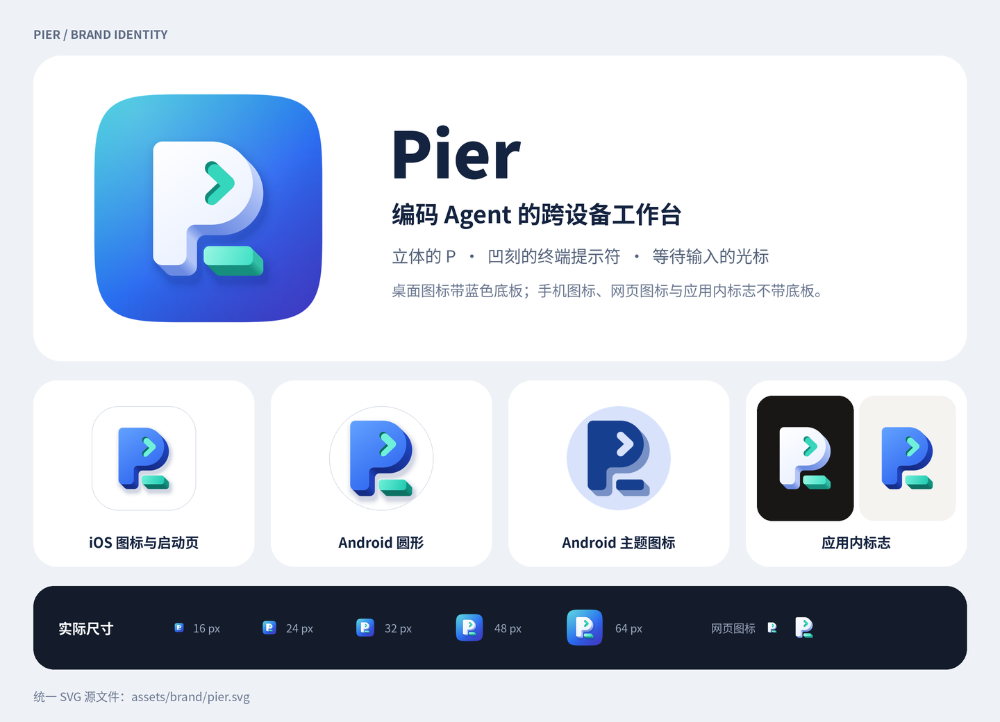

# Pier 图标

统一的矢量源文件为 `assets/brand/pier.svg`。白色线条 P 保留内部留白，青色 `>` 对应编码 Agent 与终端，底部上扬的弧线与轻巧节点对应跨设备连接。标志整体向前倾斜 5°，蓝青渐变背景与明亮的提示符增加轻盈感；标志也能独立用于单色图标。



桌面应用图标直接使用 `pier.svg` 原图（蓝青底板、白色 P），按 Apple 1024px 画布上的 824px 网格做成连续圆角底板。手机图标与浏览器 favicon 与桌面端导航栏的标志一致：只取 `mark` 分组、不带蓝青底板，并换成浅色主题的 `--logo-*` 配色（深蓝 P、青色提示符）。浏览器 favicon 是透明底、按导航栏标志裁切的标志本身；iOS 图标不能带透明通道，标志放在白底满版图上，手机启动页是同一张图的连续圆角版本。Android 自适应图标以白色为背景、标志为前景，生成前景时在保留原始倾斜变换的基础上整体缩放到 90%，使所有笔画保持在 Android 的中央 66/108 圆形安全区域内，适配圆形、圆角矩形等系统蒙版；Android 主题图标是同样缩放的白色单色标志。

Windows 安装程序（NSIS）的 setup.exe、卸载程序和向导页眉都使用桌面应用图标 `icons/icon.ico`，页眉右上角的图标由 Windows 按显示缩放从 .ico 中选取合适尺寸，因此不另设页眉位图。欢迎页与完成页左侧的 `src-tauri/nsis/sidebar.bmp` 把 `pier.svg` 的蓝青底板铺满 164×314 的竖幅，白色标志放在偏上的位置；它是 NSIS 要求的 24 位无透明通道 BMP，不含文字，因为 Windows 在 100% 以外的缩放下会直接拉伸这张位图，文字边缘最容易发虚。向导底部分隔线上的署名来自 `tauri.conf.json` 的 `bundle.copyright`，未设置时 NSIS 会显示「Nullsoft Install System」。

修改 SVG 后，在仓库根目录重新生成图片（Python 依赖 Pillow 与 CairoSVG，可通过 uv 临时提供；系统需安装 Cairo 运行库）：

```bash
uv run --with pillow --with cairosvg python apps/desktop/scripts/make-app-icon.py
cd apps/desktop
bun run tauri icon src-tauri/app-icon.png --output src-tauri/icons
```

Tauri CLI 还会生成 `icons/android` 与 `icons/ios`；手机端由 Expo 使用 `apps/mobile/assets` 中的图片，因此这两个生成目录不需要提交。修改完成后检查 16px / 32px 的可读性、浅深背景，以及 Android 圆形与圆角方形裁切；改动安装程序侧边图后，用 Release 工作流的 dry run 生成 setup.exe，查看欢迎页与完成页。
